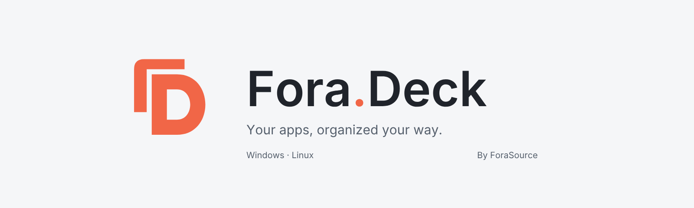

  <picture>
    <source media="(prefers-color-scheme: dark)" srcset="assets/github_header_dark.png">
    <source media="(prefers-color-scheme: light)" srcset="assets/github_header_light.png">
    
  </picture>

<strong>Your apps, organized your way.</strong>

  
  
  
  

  <a href="#features">Features</a> ·
  <a href="#get-xlibrary">Download</a> ·
  <a href="#quick-start">Quick start</a> ·
  <a href="docs/README.md">Documentation</a> ·
  <a href="#contributing">Contributing</a>

# XLibrary

XLibrary brings your everyday tools, games, and portable apps into one library on Windows and Linux.
Organize them with tags, find them from a compact launcher, and open everything you need for a project with a launch scenario.

Give your browser both `#work` and `#personal`, keep development tools under `#dev`, and find a document without leaving search.
Your catalog and settings stay on your computer. The interface supports English and Russian.

> **Under active development.** Features and interfaces are still evolving. Feedback and contributions are welcome.

## Features

| | What you can do |
| --- | --- |
| **One library** | Discover installed applications and Steam games, or add your own launch configurations. |
| **Tags and favorites** | Organize apps your way and combine text search with tag filters and exclusions. |
| **Quick search** | Find apps by name, filename, or alias, with typo and English/Russian keyboard layout correction. |
| **Files and calculations** | Search supported documents and media by filename, save them to My files, browse folders, or calculate an expression. |
| **Launch scenarios** | Open a group of apps in a defined order, with optional delays and browser profiles. |
| **Desktop integration** | Assign shortcuts, switch to running apps where supported, or launch a new instance. |
| **Make it yours** | Choose a light, dark, or system theme, adjust text size, and use English or Russian. |
| **Keep your library** | Transfer application entries as JSON or create a complete profile backup. |

## Get XLibrary

Download a package from [GitHub Releases](https://github.com/lappland-open/XLibrary/releases).
Pre-releases are development builds; read the release notes before upgrading.

| Platform | Package |
| --- | --- |
| **Windows 10/11 x64** | Use the installer, or extract the portable ZIP into a writable folder and run `XLibrary.exe`. |
| **Linux x86_64** | Use the DEB on Debian 13, or the AppImage on a compatible system. See [Linux setup](docs/usage.md#linux-setup). |

For a portable upgrade, keep the existing profile data. See [profiles and backups](docs/profile.md) and [updates](docs/updates.md).
To build from source, start with [BUILDING.md](BUILDING.md).

## Quick start

1. Open XLibrary and choose discovery, manual entry, or profile restoration on the welcome screen.
2. Add tags and favorites to the apps you use most.
3. Open quick search with <kbd>Ctrl</kbd> + <kbd>Alt</kbd> + <kbd>Space</kbd>, type a name, and press <kbd>Enter</kbd>.
   On Wayland, configure a shortcut first; see [Linux setup](docs/usage.md#linux-setup).

Try `code`, `#dev code`, or `#work -#games`. Turn on file search to find `*.pdf`, or enter `(2 + 3) * 4` to calculate and copy a result.
The full library opens with <kbd>Ctrl</kbd> + <kbd>Alt</kbd> + <kbd>Shift</kbd> + <kbd>Space</kbd>.
Shortcuts can be changed in settings, and XLibrary must be running for its built-in global shortcuts.

See the [user guide](docs/usage.md) for search, file indexing, shortcuts, and scenarios, or [catalog management](docs/catalog.md) for discovery and import.

## Contributing

Bug reports, interface feedback, documentation improvements, and focused pull requests are welcome.

- [Report a bug](https://github.com/lappland-open/XLibrary/issues/new) with reproduction steps, your OS and desktop session, and relevant screenshots.
- [Suggest an improvement](https://github.com/lappland-open/XLibrary/issues) and describe the workflow it would help with. Discuss larger changes before implementing them.
- For code contributions, read the [architecture](docs/architecture.md), [build instructions](BUILDING.md), and [verification guide](docs/testing.md).

XLibrary is built with C++23, Qt 6 Widgets, and SQLite. See the [documentation index](docs/README.md) for technical guides.

## License

XLibrary is released under the [MIT License](LICENSE).
